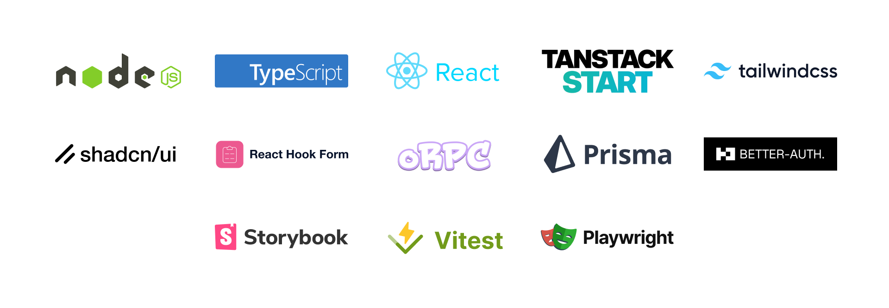

<h1 align="center"></h1>

🚀 Start UI <small>[web]</small> is an opinionated frontend starter repository created & maintained by the [BearStudio Team](https://www.bearstudio.fr/team) and other contributors.
It represents our team's up-to-date stack that we use when creating web apps for our clients.


## Technologies

<div align="center" style="margin: 0 0 16px 0"></div>

[⚙️ Node.js](https://nodejs.org), [🟦 TypeScript](https://www.typescriptlang.org/), [⚛️ React](https://react.dev/), [📦 TanStack Start](https://tanstack.com/start), [💨 Tailwind CSS](https://tailwindcss.com/), [🧩 shadcn/ui](https://ui.shadcn.com/), [📋 React Hook Form](https://react-hook-form.com/), [🔌 oRPC](https://orpc.unnoq.com/), [🛠 Drizzle ORM](https://orm.drizzle.team/), [🔐 Better Auth](https://www.better-auth.com/), [🪐 React Cosmos](https://reactcosmos.org/), [🧪 Vitest](https://vitest.dev/), [🎭 Playwright](https://playwright.dev/)

## Documentation

For detailed information on how to use this project, please refer to the [documentation](https://docs.web.start-ui.com). The documentation contains all the necessary information on installation, usage, and some guides.

## Requirements

* [Node.js](https://nodejs.org) 24.x
* [pnpm](https://pnpm.io/)
* [Docker](https://www.docker.com/) (or a [PostgreSQL](https://www.postgresql.org/) database)

## Getting Started

```bash
pnpm create start-ui -t web myApp
```

That will scaffold a new folder with the latest version of 🚀 Start UI <small>[web]</small> 🎉

## Setup your IDE

- VS Code
```bash
cp .vscode/settings.example.json .vscode/settings.json
```

- Zed
```bash
cp .zed/settings.example.json .zed/settings.json
```

## TypeScript Path Aliases

This project uses Vite's native `resolve.tsconfigPaths: true` option to resolve aliases from `tsconfig.json`. If you need TypeScript path aliases in a Vite 8 project, check the [Vite paths documentation](https://vite.dev/guide/features#paths) before installing an extra plugin.

## Installation

```bash
cp .env.example .env  # Setup your env variables
pnpm install          # Install dependencies
pnpm dk:init          # Start Docker containers (PostgreSQL, MinIO)
pnpm db:init          # Push the Drizzle schema and seed the database
```

> [!NOTE]
> **Don't want to use docker?**
>
> Setup a PostgreSQL database (locally or online) and replace the **DATABASE_URL** environment variable. Run `pnpm db:push` to update the schema. Demo seeding requires a direct loopback PostgreSQL connection in a non-production runtime. Do not use a localhost tunnel to a remote database.

## Run

```bash
pnpm dk:start # Only if your Docker containers are not running
pnpm dev
```

## Verification

```bash
pnpm check           # Static checks: format, lint, types, architecture, test layering, security, audit
pnpm test            # Unit, browser, and integration tests
pnpm test:property   # Focused property/invariant tests
pnpm test:e2e        # Full Playwright user journeys
pnpm verify          # Full local pre-merge gate
pnpm verify:task     # Task verification logs; add --visual, --e2e-chromium, or --build as needed
```

`pnpm verify:task` writes timestamped logs under `test-results/task-verification/`. Its optional flags add visual regression tests (`--visual`), Chromium E2E (`--e2e-chromium`), and a production build (`--build`). See [AGENTS.md](AGENTS.md) and [Testing Strategy](TESTING.md) for the full verification workflow.

## Auth Route Freshness

Authenticated route guards live in TanStack Router `beforeLoad` hooks on the protected layout routes. The guards share the `auth.currentSession` query through router context so SSR requests and concurrent route checks use one sanitized session read.

Freshness differs by route:

* `/manager` passes `requireFresh: true` to `requireAuthenticatedRouteOrForbidden`. Client navigations always refetch the current session before allowing the manager shell, so revocation, sign-out, and role changes are observed before privileged manager UI renders.
* `/app`, `/login`, and `/onboarding` use the default session freshness. On SSR they fetch from the request context; on the client they may reuse the current-session query cache when it already has a value, and fetch when it does not. Auth boundary actions such as sign-in, onboarding completion, and sign-out clear or refresh the session cache and invalidate the router so the relevant `beforeLoad` hook reruns.

Use `requireFresh: true` for protected routes whose UI or loaders must observe authorization changes before render. The default cached session path is acceptable for lower-risk route transitions where avoiding an extra client fetch is preferred.

## Observability

The app uses OpenTelemetry for traces, metrics, and server-emitted logs, with Sentry kept for rich error tracking. Browser telemetry must stay same-origin:

* Browser OTel traces and metrics are exported with OTLP/HTTP protobuf to `/api/telemetry/otel/v1/traces` and `/api/telemetry/otel/v1/metrics`.
* Browser Sentry sends errors only, disables browser tracing, and uses the `/api/telemetry/sentry-tunnel` tunnel.
* Frontend logs are batched to `/api/telemetry/logs`; production source should use `frontendLogger` instead of `console.*`.
* Browser fetch instrumentation only propagates `traceparent` and `baggage` to same-origin requests and ignores `/api/telemetry/*`.
* Server OTel exports directly to `OTEL_COLLECTOR_URL` when configured. Without that env, server export is no-op and local/test proxy summaries can be written to `.telemetry/telemetry.sqlite`.

The telemetry layer derives Query and mutation operation names from static TanStack Query key segments, such as `design.getAll`. Dynamic key values are hashed before becoming attributes; raw dynamic values are only exposed in localhost/debug mode. Route loaders and `beforeLoad` guards are wrapped with route-level spans so navigation time, guard time, loader time, and Query time can be separated.

TanStack Query retry policy is intentionally bounded: queries retry transient/network and 5xx-style failures up to two times, do not retry numeric 4xx client errors, and mutations do not retry by default. Keep query keys aligned with `validateSearch` and `loaderDeps` for routes that read search params.

Optional local Collector:

```bash
docker compose --profile observability up otel-collector
```

The Collector receives OTLP/HTTP on port `4318` and exports to debug, Sentry OTLP, and Honeycomb OTLP exporters using the env vars in `.env.example`. Production browser CSP should not need Sentry, Honeycomb, or Collector origins in `connect-src`; browser traffic goes through the app proxy routes.

TypeScript is configured for ES2024 syntax. The Vite browser build target stays on the evergreen baseline (`baseline-widely-available`) rather than targeting IE-era browsers.

### CodeQL

CodeQL runs in GitHub Actions with the default and `security-extended` query suites plus repo-local queries under `.github/codeql/start-ui-web-queries`. Local CodeQL commands call the CodeQL CLI directly, install the local query pack dependencies first, and require the [CodeQL CLI](https://github.com/github/codeql-cli-binaries/releases) on your `PATH`.

```bash
pnpm codeql:test     # Compile and test local custom queries
pnpm codeql:db       # Create test-results/codeql/start-ui-web-db
pnpm codeql:analyze  # Analyze that DB and write test-results/codeql/start-ui-web.sarif
```

### Emails in development

#### Resend delivery

Emails are sent with [Resend](https://resend.com). Configure `RESEND_API_KEY`
with a Resend API key and set `EMAIL_FROM` to a sender from a verified domain.
Set `RESEND_WEBHOOK_SECRET` to the Resend/Svix signing secret for
`/api/webhooks/resend` delivery status callbacks.
Use `EMAIL_DELIVERY_DISABLED=true` when a workflow should skip delivery, such
as automated end-to-end test runs.

### OpenAPI Documentation for the API

You can access the API documentation via the OpenAPI interface at:

`http://localhost:3000/api/openapi/app`

This interface allows you to:

* View complete and up-to-date documentation of all backend endpoints exposed by the API.

* Understand request and response formats for each route.

* Facilitate development and debugging by testing endpoints directly from the interface, without needing the frontend.

### Generate custom icons components from svg files

Put the custom svg files into the `src/platform/components/icons/svg-sources` folder and then run the following command:

```bash
pnpm gen:icons
```

If you want to use the same set of custom duotone icons that Start UI is already using, checkout
[Phosphor](https://phosphoricons.com/)

> [!WARNING]
> All svg icons should be svg files prefixed by `icon-` (example: `icon-external-link`) with **square size** and **filled with `#000` color** (will be replaced by `currentColor`).

### E2E Tests

E2E tests are setup with Playwright.

```sh
pnpm e2e:setup  # Setup context to be used across test for more efficient execution 
pnpm e2e        # Run tests in headless mode, this is the command executed in CI
pnpm e2e:ui     # Open a UI which allows you to run specific tests and see test execution
```

> [!WARNING]
> The generated e2e context files contain authentication logic. If you make changes to your local database instance, you should re-run `pnpm e2e:setup`. It will be run automatically in a CI context.
## Production

```bash
pnpm install
pnpm cosmos-export # Optional: Build the React Cosmos component library export
pnpm build
pnpm start
```

When rolling forward from an older deployment, unset any legacy
`PROVIDER_CALLBACK_MODE` value other than `poll` before deploying. Server
configuration accepts polling only.

## Manual model smoke

Run `pnpm smoke:model <model-id>` to write a synthetic source, reference, provider mask when applicable, and request preview under `test-results/smoke-model-*`. Model IDs are `krea-3`, `flux-3-image`, `ideogram-4-5`, and `gpt-image-2`.

To submit one paid request, configure `PROVIDER_MODE=live`, provider keys, and private HTTPS object storage, then add `--live`. The script uploads only synthetic images under the bucket's `smoke-model/` prefix and gives the provider short-lived signed URLs. Set a lifecycle policy on this prefix or clean it up after testing. Review the source and output side by side for target placement, framing, and changes outside the target. The script saves the result, elapsed time, and available cost data locally.

## Deploy

This app is a TanStack Start app with Nitro already enabled in `vite.config.ts`. `pnpm build` creates the production `.output` directory, and `pnpm start` runs `.output/server/index.mjs`.

Sign-in uses email and password. Public signup is disabled. An operator can change the login email in the user manager; the existing password works with the new address without an email verification or confirmation step. The local seed creates a development admin and user with the same password. Set `SEED_ACCOUNT_PASSWORD` for both the seed and browser tests if you override the local default, `local-development-only-password`. Rerunning the seed preserves existing passwords. Use the operator reset command if you change the value for an existing local account.

To provision an account, run the operator CLI in a terminal configured for the intended database. It generates a password and displays it once after creating the account. Share it privately with the invited user.

```sh
pnpm auth:password create person@example.com "Person" user
```

Use `admin` to provision an operator account. For recovery, run `pnpm auth:password reset person@example.com` with the new password on standard input. Use a unique password of 12–128 characters. The reset revokes sessions through the configured Better Auth store. Configure shared Upstash storage on Vercel so the operator process and application use the same session and rate-limit state. Restart a local process using in-memory storage after recovery to clear its sessions.

Before deploying anywhere:

* Use Node.js 24 or newer to match the current `package.json` engine.
* Set production values for the required variables in `.env.example`, especially `DATABASE_URL`, `AUTH_SECRET`, `VITE_BASE_URL`, S3 storage, email configuration, `FAL_KEY`, `BFL_API_KEY`, and any public `VITE_*` values.
* Point `VITE_BASE_URL` at the deployed HTTPS URL. For preview domains, also configure `AUTH_ALLOWED_HOSTS` as needed.
* Production builds require both model keys. The GitHub Actions compilation job uses placeholders that Vercel rejects.
* Run your versioned migration command against the production database before serving production traffic. Do not use `pnpm db:push` for production deployments because it bypasses migration history.

<details>
<summary><strong>Cloudflare Workers</strong></summary>

Cloudflare's TanStack Start guide supports existing projects through Wrangler automatic configuration.

```bash
pnpm dlx wrangler login
pnpm dlx wrangler deploy
```

Wrangler can detect TanStack Start and generate the Worker configuration for `.output/server/index.mjs`, `.output/public`, and the `nodejs_compat` compatibility flag.

For Workers Builds from the Cloudflare dashboard:

* Deploy command: `pnpm dlx wrangler deploy`
* Build variables: set `NODE_VERSION=24` and `PNPM_VERSION=11.9.0`
* Secrets and environment variables: add the production values from `.env.example`

For source-controlled Worker configuration, install Wrangler and the Cloudflare Vite plugin, then follow Cloudflare's existing-app setup for `vite.config.ts` and `wrangler.jsonc`.

```bash
pnpm add -D wrangler @cloudflare/vite-plugin
```

Cloudflare Workers is not a normal Node server, so validate database, storage, and email dependencies with Workers-compatible providers or bindings instead of local Docker, MinIO, and Maildev URLs.

Docs: [Cloudflare TanStack Start](https://developers.cloudflare.com/workers/framework-guides/web-apps/tanstack-start/), [Workers Builds image](https://developers.cloudflare.com/workers/ci-cd/builds/build-image/)

</details>

<details>
<summary><strong>Vercel</strong></summary>

Vercel supports TanStack Start with Nitro, and this repo already has the required `nitro()` Vite plugin.

Deploy from Git:

1. Import the repository in Vercel.
2. Use the TanStack Start preset if it is shown, otherwise use the default project settings.
3. Set Node.js Version to `24.x`.
4. Set Build Command to `pnpm build`.
5. Leave Output Directory empty/default.
6. Add the environment variables from `.env.example`. Use a pooled Neon URL, a private R2 bucket with CORS for the app origin, and Upstash for shared auth state.
7. Deploy.

Deploy from the CLI:

```bash
pnpm dlx vercel
pnpm dlx vercel --prod
```

For Vercel preview URLs, this app can derive `VITE_BASE_URL` from Vercel's preview environment variables when `VITE_BASE_URL` is not set. Add `AUTH_ALLOWED_HOSTS="*.vercel.app"` if auth should accept Vercel preview hosts.

Docs: [TanStack Start on Vercel](https://vercel.com/docs/frameworks/full-stack/tanstack-start), [Vercel Node.js versions](https://vercel.com/docs/functions/runtimes/node-js/node-js-versions)

</details>

<details>
<summary><strong>Railway</strong></summary>

Railway deploys TanStack Start as a standard Node service. Railpack detects `package.json`, installs pnpm from `packageManager`, runs the `build` script, and uses the `start` script.

Deploy from Git:

1. Create a Railway project and deploy from the GitHub repository.
2. Add a PostgreSQL service or connect an external PostgreSQL database.
3. Add the production environment variables from `.env.example`.
4. Set `RAILPACK_NODE_VERSION=24` if Railway does not pick Node 24 from `package.json`.
5. Generate a public domain in the service Networking tab.
6. Set `VITE_BASE_URL` to that public URL and redeploy.

Deploy from the CLI after installing and authenticating the Railway CLI:

```bash
railway init
railway up
```

If detection fails, set explicit commands in the service settings:

```text
Build Command: pnpm build
Start Command: pnpm start
```

Nitro reads Railway's `PORT` environment variable automatically.

Docs: [Railway TanStack Start](https://docs.railway.com/guides/tanstack-start), [Railway CLI deploys](https://docs.railway.com/cli/deploying), [Railpack Node.js](https://railpack.com/languages/node)

</details>

<details>
<summary><strong>Render</strong></summary>

Render should be configured as a Node Web Service that builds the Nitro output and starts the generated Node server.

Dashboard settings:

```text
Runtime: Node
Build Command: pnpm i --shamefully-hoist && pnpm build
Start Command: node .output/server/index.mjs
```

Environment variables:

```text
NITRO_PRESET=render-com
NODE_VERSION=24
HOST=0.0.0.0
```

Also add the production values from `.env.example`. Render provides `PORT`; Nitro reads `PORT` automatically.

Optional `render.yaml`:

```yaml
services:
  - type: web
    name: start-ui-web
    env: node
    buildCommand: pnpm i --shamefully-hoist && pnpm build
    startCommand: node .output/server/index.mjs
    envVars:
      - key: NITRO_PRESET
        value: render-com
      - key: NODE_VERSION
        value: 24
      - key: HOST
        value: 0.0.0.0
```

Docs: [Nitro on Render](https://nitro-docs.pages.dev/deploy/providers/render/), [Render deploys](https://render.com/docs/deploys), [Render Node.js versions](https://render.com/docs/node-version)

</details>

## Show hint on development environments

Setup the `VITE_ENV_NAME` env variable with the name of the environment.

```
VITE_ENV_NAME="staging"
VITE_ENV_EMOJI="🔬"
VITE_ENV_COLOR="teal"
```

## FAQ

<details><summary><strong>git detect a lot of changes inside my <code>.husky</code> folder</strong></summary>
<p>
You probably have updated your branch with lefthook installed instead of husky. Follow these steps to fix
your hooks issue:
<ul>
  <li><code>git config --unset core.hooksPath</code></li>
  <li><code>rm -rf ./.husky</code></li>
  <li><code>pnpm install</code></li>
</ul>

From now husky should have been removed; and lefthook should run your hooks correctly.
</p>
</details>

## Provider accounting recovery

Renders, cutouts and SAM calls capture durable receipts for each provider request. Once captured, a cost-log delivery outage does not block usable output. Receipts survive Retry and parent deletion; no provider call is made by accounting recovery.

Cost-log delivery runs only in accounting workers, with bounded lock and statement waits. Prompt dispatch happens after the output operation and never delays an interactive response. Workflow execution owns worker dispatch; Vercel [`waitUntil`](https://vercel.com/docs/functions/functions-api-reference/vercel-functions-package) owns HTTP background dispatch. Local or unsupported request lifetimes use daily/operator reconciliation. Dispatch is observed for at most five seconds; its failure leaves the durable receipt for reconciliation. Reconciliation processes pages of 100 with five continuously replenished delivery slots per workflow. Failed delivery gets bounded prompt workflow retries. A Vercel Cron invokes `/api/internal/accounting/reconcile` daily at **07:00 UTC** as a backstop. Set `CRON_SECRET` to at least 32 URL-safe random characters in the production environment before deployment. Missing or incorrect authorization is rejected. Production runtimes, including deployments outside Vercel, require a private secret. Previews may omit it to disable the endpoint; deployments reject the documented local example. Scheduled jobs run only against production; preview and local verification invoke the handler explicitly.

Accepted render submissions are journaled before receipt/submission persistence. Durable persistence retries reuse that acceptance until the original 30-minute deadline; unresolved attempts then remain owner-retryable. Permanent identity or validation errors fail visibly without automatically buying another request. A superseded accepted request can remain submitted with unavailable final cost. No independent polling is added for abandoned requests.

Replaced render outputs have a durable cleanup queue written atomically with Retry. The replacement owns prompt cleanup; `/api/internal/rendering/cleanup` redrives pending records daily at **07:00 UTC** with the same `CRON_SECRET` authentication. Operators can run `pnpm rendering:cleanup` without invoking providers. Cleanup validates the original result/attempt key, checks image and checkpoint references, and retains objects on uncertainty. Records survive parent deletion; no historical objects are scanned or backfilled. Apply migration 0016 before deploying. It creates a new empty table and its pending index; prior migrations and their rollout constraints remain unchanged.

For a local production build or `pnpm verify`, supply all existing synthetic build settings and a fresh private cron secret, for example `CRON_SECRET="$(openssl rand -hex 32)" pnpm build`. This is a compilation credential, not a reason to copy the public development example into production. Production runtime secret validation remains enabled. Non-Vercel hosts need an external schedule or the operator commands; Vercel cron is not installed on those hosts.

Operators can redrive pending accounting with `pnpm accounting:reconcile`. The command reports delivered, failed and remaining receipts and closes its database client. Monitor `provider_accounting.delivery_failed`, `provider_accounting.dispatch_failed` and `provider_accounting.summary`; summaries include the pending count and oldest pending age. Exhausted delivery leaves receipts pending for the next reconciliation.

Apply the additive accounting migration before serving the new app. The new ordinary indexes on image object keys and render checkpoint keys take a write lock while PostgreSQL builds them; coordinate rollout with writers, as for migration 0012. Existing migrations are immutable. Online index builds, historical accounting repair and orphan sweeps remain outside this release.

Only an owning workflow may fail a render. If execution never claims ownership, the result stays pending and its owner can start a fresh, potentially paid attempt after 30 minutes. Replaced output deletion is best effort after confirmed loss and global reference checks.


Render acceptance always gets one database persistence attempt, even after its original 30-minute deadline. Further recovery retains that cutoff. Delivery is dispatched only after receipt capture is confirmed; an unconfirmed capture may remain solely in the workflow journal, and daily accounting reconciliation cannot recreate it.

Apply migration **0017** before deploying this change. It adds the independent blocked-cleanup registry; prior migrations remain unchanged. Invalid checkpoint keys retain their files and produce blocked evidence in the Retry transaction instead of blocking the user. Invalid queued targets are quarantined before storage access. `pnpm rendering:cleanup` reports blocked counts and static reasons as well as completed and failed work. Blocked evidence and completed queue records are retained; no automatic repair or pruning is provided. Explicit operator recovery is described below. Queue eligibility, leases and snapshot pagination use database time and the indexed time/key order. No active workflows require adoption for this release.

### Blocked render cleanup recovery

Apply migration **0018** before deploying. It adds a nullable safe locator to blocked evidence and a new append-only recovery audit table with its lookup index. No existing fingerprints or accounting are backfilled. The additive changes still require brief schema locks; preserve earlier migration rollout constraints.

```sh
pnpm rendering:cleanup                         # Sweep eligible cleanup work
pnpm rendering:cleanup blocked 100             # Recent blocked evidence; no locators
pnpm rendering:cleanup inspect FINGERPRINT     # Explicit privileged locator/history inspection
pnpm rendering:cleanup requeue FINGERPRINT RESULT_ID ATTEMPT
pnpm rendering:cleanup                         # Process repaired work without calling providers
```

Requeue uses the retained locator, never a supplied key. It accepts only the exact `results/<result>/<attempt>/raw.<extension>` target and enqueues normal reference-checked cleanup. Safe locators are bounded, unchanged ASCII relative paths; URLs, query strings, encoded escapes, traversal, whitespace and malformed values remain fingerprint-only. Normal logs and HTTP responses never expose locators. Existing fingerprint-only evidence reports `locator_unavailable`; there is no historical scan or reconstruction.

Repair and audit commit atomically. Existing pending jobs keep their leases. An operator may explicitly recheck a previously retained object, with its old completion outcome saved in history; deleted-object tombstones stay closed. Requeue alone does not access storage or contact providers. Referenced objects remain retained, and uncertain reference checks or deletion failures remain pending. If a repair write is uncertain, the command prints its request identity; inspect the evidence/history before issuing another request. Records survive parent deletion and do not pin objects.

Sweep reports use `completed`, `failed` and `blockedThisRun` for this execution, plus `blockedTotal` and reason counts for all retained blocked evidence, including evidence linked to past repair requests. Unknown CLI arguments fail instead of starting a sweep.

A valid journaled acceptance receives its initial fenced save even if the retry deadline is malformed. Successful persistence continues the current request. If persistence fails, recovery can restore the original cutoff from the matching owned attempt’s database start time. A reconciled save continues polling; unresolved persistence remains pending/submitted when reconciliation is unavailable or the cutoff is exhausted. It never creates a new deadline, treats uncertainty as rollback, or makes another provider submission. Valid deadlines retain the original 30-minute cutoff.

### Safe cleanup intervention and replay

Apply migration **0020_faithful_micromacro.sql** after earlier migrations and before deploying. It extends allowed acknowledgment reasons and adds durable acknowledgment request aliases. Its constraint replacement/validation and foreign-key creation require coordinated schema locks. Existing evidence and audit events are unchanged; earlier migrations remain immutable.

Cleanup repair permits replaced attempts, missing parents and terminal current attempts. A current pending/submitted attempt or future attempt is ineligible, even when its output is not yet referenced. Workers quarantine unexpectedly active queued targets before storage access; finishing the render does not automatically revive that cleanup. Explicit repair is required later. Every eligible deletion still checks global image and checkpoint references.

```sh
pnpm rendering:cleanup blocked 100                    # Historical view; safe metadata only
pnpm rendering:cleanup blocked 100 --outstanding      # Still requires operator intervention
pnpm rendering:cleanup blocked 100 --after CURSOR     # Use the previous response's nextCursor
pnpm rendering:cleanup requeue FINGERPRINT RESULT_ID ATTEMPT --request-id UUID
pnpm rendering:cleanup acknowledge FINGERPRINT --request-id UUID
```

Requeue and acknowledgment print a generated request ID before writing when none is supplied. Reuse the printed ID with the identical command to replay an uncertain outcome; changing its action or target returns a conflict. Inspection includes the retained audit history. Each fingerprint has one canonical acknowledgment; fresh acknowledgment request IDs become durable aliases rather than duplicate audit events. Successful acknowledgment responses include `requestId` and `canonicalRequestId`. Matching old request replays remain valid after repair handoff; cross-action or different-fingerprint reuse conflicts. Existing duplicate historical acknowledgments stay unchanged, with the earliest as canonical. Acknowledgment accepts deliberate retention of any blocked target, including safe non-render locators and active attempts. It records `locator_unavailable_retained` when there is no validated locator, or `operator_retained` otherwise, without accessing storage or changing the render. It cannot accept a replacement key or bypass deletion safeguards. New acknowledgments are refused after repair handoff and never cancel queued cleanup. A later explicit repair of acknowledged evidence remains possible and changes its intervention state to `handed_off`.

`blockedTotal` and its reason counts include all retained evidence. `blockedOutstanding` and `outstandingReasons` count only evidence without a successful audited handoff or acknowledgment. A matching pending/completed cleanup job counts as handoff; workers then own remaining cleanup. Reports retain execution-local `completed`, `failed` and `blockedThisRun` separately. No evidence, audit events or completion tombstones are pruned or backfilled.

Submission reconciliation uses one database snapshot and compares the full saved submission. A match confirms receipt capture under the capture-before-save contract, including after a lost step reply. Read-only reconciliation uses three total SDK attempts with five-second delays for transient failures; it may confirm an existing save after the cutoff, but cannot extend the original deadline for submission writes. Interrupted recovery preserves confirmed accounting delivery and records safe unresolved diagnostics without another provider submission.

Polling uses the pinned SDK’s durable suspension and completion behavior directly; unexpected workflow exceptions use the existing failure handler. Submission-persistence recovery still reconciles uncertain writes after an interrupted wait. Capture confirmation comes from application outcomes, including captured work that loses its submission fence, and confirmed accounting dispatch remains independent of publication. Manual Retry remains a fresh, potentially paid attempt, with the existing 30-minute deadline for pending/submitted work. Deterministically invalid render rows fail without transient retries across repository readers; database outages retain normal retries.

A blocked submission’s failure retries preserve the original reason, workflow owner, attempt and provider-request fence, including permission to fail that owned pending submission. A secondary database failure is logged separately; it cannot change the failure mode or imply supersession. Computed recovery deadlines must also fit JavaScript’s date range before formatting.

For local native-driver recovery verification, provision a direct disposable loopback PostgreSQL database whose name begins with `selective_designer_recovery_test_`, then run:

```sh
RECOVERY_TEST_DATABASE_URL=postgres://postgres@127.0.0.1:5432/selective_designer_recovery_test_local \
  pnpm test:integration tests/integration/modules/rendering/render-repository-drizzle.integration.test.ts
```

This suite migrates and truncates that database. Do not point it at shared data or a localhost tunnel to a remote database. Driver-specific cases, including unreadable timestamps and computed deadline overflow, remain skipped in CI and when this variable is absent. The SDK sleep contract checks the public export’s normal suspension/completion lifecycle; it does not guarantee every possible behavior of future SDK versions.

Failure recording uses replay-safe, fenced writes and workflow-owned backoff for up to two minutes. If it cannot confirm persistence, the workflow reports an internal unresolved outcome instead of claiming the render was marked failed. Its saved state and 30-minute owner Retry deadline remain unchanged; confirmed accounting still dispatches. A manual Retry remains a fresh, potentially paid attempt.

Invalid attempt timestamps return permanent validation errors and require operator data repair. Pending/submitted starts may be at most five minutes ahead of the injected server clock, inclusive; historical terminal records retain structural validation without a future-time limit. A suspicious future recovery deadline is checked against the original persisted start rather than extending the cutoff. No automatic timestamp repair or new repair UI is provided.
